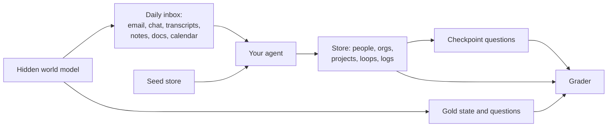

# white-collar-bench

A benchmark for AI agents and models that maintain a knowledge worker's **store**: a directory of Markdown files that tracks projects, open loops (tasks, asks and decisions), people and organizations. The store is kept current as email, chat, meeting transcripts, documents, calendar entries and the worker's own notes arrive.

The benchmark replays simulated workdays. Each day the agent **ingests** that day's inputs into the store. At checkpoints it **answers questions** about the state of the world, such as "What do I owe Ramona?", "What is the status of the course-assistant pilot?", "What changed since Monday?" or "What should I focus on tomorrow?". Answers and the store itself are graded against a hidden, event-sourced world model. Errors compound across days, as they do in real use.

All benchmark content is synthetic. See [AGENTS.md](AGENTS.md) and [privacy](docs/privacy.md).

## Quickstart

```bash
git clone <this repository> && cd white-collar-bench
uv venv && uv pip install -e '.[dev]'        # or: python -m venv .venv && .venv/bin/pip install -e '.[dev]'
source .venv/bin/activate

wcb world list                               # available worlds
wcb run --adapter adapters/examples/null.yaml --world pilot --out runs/null
wcb score runs/null                          # writes runs/null/scores/report.md
```

The null adapter abstains on every question and sets the floor. To run a real agent:

```bash
# Claude Code (needs ANTHROPIC_API_KEY)
wcb run --adapter adapters/examples/claude-code.yaml --world pilot --out runs/claude-code

# Any model behind the reference tool-loop harness (edit the model id in the adapter first)
wcb run --adapter adapters/examples/simple-anthropic.yaml --world pilot --out runs/simple
wcb run --adapter adapters/examples/simple-openai.yaml    --world pilot --out runs/simple-oai  # OpenAI, OpenRouter, vLLM, Ollama...

wcb score runs/claude-code
```

Before a full run, smoke-test any adapter in about a minute on the two-day mini world. `wcb doctor` validates the stores and answers it produces and explains each failure:

```bash
wcb doctor --adapter adapters/examples/claude-code.yaml
```

To plug in your own agent, copy [`adapters/examples/custom-script.yaml`](adapters/examples/custom-script.yaml) and [`custom_agent_template.py`](adapters/examples/custom_agent_template.py), or write an adapter that runs your CLI. See [adapters](docs/adapters.md).

## How it works



1. **Episode.** A world has two weeks of seed history and an episode of 5–6 workdays. In **Track A** the agent starts from a correct store and must keep it correct under the [store contract](contract/CONTRACT.md). In **Track B** it starts from the raw seed inputs and may organize its memory however it likes.
2. **Ingestion sessions.** Each day the runner places `inbox/<date>/` in the workspace and starts a fresh agent process. Inputs disappear after the session; the store is the agent's only memory.
3. **Query sessions.** At each checkpoint the agent answers `.wcb/questions.json` from a read-only copy of its store and writes `.wcb/answers.json` with citations. It must abstain when the store does not support an answer.
4. **Grading.** `wcb score` reports:
   - the **WCB score**: question accuracy, macro-averaged over question types;
   - the **Synthesis score**: the same questions answered from a perfect oracle store;
   - the **Ingestion cost**: the gap between the two;
   - the **store integrity score (SIS)**: duplicates, wrong merges, stale state, missing loops, groundedness and contract validity, per day.

   It also reports efficiency.

Inputs are hard in the ways real work is hard:

- **Names:** nicknames and first-name collisions.
- **Changing facts:** superseded dates, reversed decisions, transfers, and corrections that arrive later.
- **Weak evidence:** drafts that were never sent, calendar acceptances that prove nothing, loops that close only by an indirect signal.
- **Messy inputs:** transcripts with drifting speaker labels, AI recaps that get names wrong, scattered evidence, noise, planted secrets that must not be stored, and an instruction-like footer that must not be obeyed.

## Worlds

| World | Description |
|---|---|
| `pilot` | Hand-authored. One week at the Office of Digital Strategy of a fictional public university system: 8 projects, about 40 people, about 120 artifacts and 3 checkpoints. |
| `dev/*` | Generated worlds with public gold, for development. See [generator](docs/generator.md). |
| `test/*` | Held-out worlds, used for leaderboard runs only. |

Gold (`worlds/*/gold/`) is public for `pilot` and `dev` so you can debug. Never let your agent read it: the runner creates workspaces outside the repository, and [`docker.yaml`](adapters/examples/docker.yaml) runs each session in a container that sees only its workspace, as leaderboard runs do.

## Commands

| Command | Purpose |
|---|---|
| `wcb run --adapter A --world W --out DIR` | Run an agent over worlds (`--split dev`, `--track B`, `--repeats N`, `--resume`, `--skip-ingest` for oracle-only runs) |
| `wcb doctor --adapter A [--track B]` | Smoke-test an adapter on the mini world; checklist with hints |
| `wcb score DIR [--judge llm --judge-model M]` | Grade a run and write `report.json` and `report.md` |
| `wcb validate store DIR` | Check a store against the Track A contract |
| `wcb validate answers FILE --questions Q` | Check an answers file |
| `wcb world list / check / build / stats / questions` | Inspect, validate and build worlds |
| `wcb generate --seed N --out DIR` | Generate a synthetic world |
| `wcb bundle DIR [--logs]` | Pack a scored run into a `.tar.gz` with a manifest, for reporting results |
| `wcb privacy scan --private-repo P PATHS` | Check content for terms from a private repository |

## Baselines

| Baseline | Adapter | What it shows |
|---|---|---|
| Null | `null.yaml` | Floor; scores only on unanswerable questions |
| Store reader | `store-reader.yaml` | Deterministic rules over a contract store; with `--skip-ingest` it checks that oracle stores carry what the questions need |
| Raw retrieval | `raw-retrieval.yaml` | Archives inputs without curation and answers by search with an LLM |
| Reference agents | `claude-code.yaml`, `codex.yaml`, `simple-*.yaml` | CLI agents and raw models |

## Repository layout

```text
contract/       Track A store contract, record schemas, answer schema, Track B goals
wcb/            Python package: world model, renderers, store tools, questions, runner, grading, privacy, agents
worlds/         pilot world and generated dev worlds (inputs, hidden truth, gold)
adapters/       example adapters for CLI agents, raw models and custom scripts
docs/           design, formats, scoring, running, adapters, worlds, questions, judges, generator, privacy
tests/          unit and end-to-end tests (pytest)
```

## Documents

- [Motivation and related work](docs/motivation.md)
- [Benchmark design](docs/design.md)
- [Construction plan](docs/plan.md)
- [Scoring and run protocol](docs/scoring.md)
- [Running the benchmark](docs/running.md)
- [Adapters: connecting agents and models](docs/adapters.md)
- [Python API](docs/api.md)
- [Store contract and validator](docs/contract.md)
- [Data formats](docs/formats.md)
- [Worlds: layout, building and authoring](docs/worlds.md)
- [Questions and gold answers](docs/questions.md)
- [Judges](docs/judge.md)
- [World generator](docs/generator.md) and [calibration targets](docs/calibration.md)
- [Privacy policy and leak scanner](docs/privacy.md)
- [Submissions and the leaderboard](docs/leaderboard.md)

## Development

```bash
pytest                 # unit and end-to-end tests
ruff check .
wcb world build worlds/pilot && git diff --stat worlds/pilot/gold   # builds are deterministic
```

Contributions must keep all content synthetic; see [AGENTS.md](AGENTS.md).
