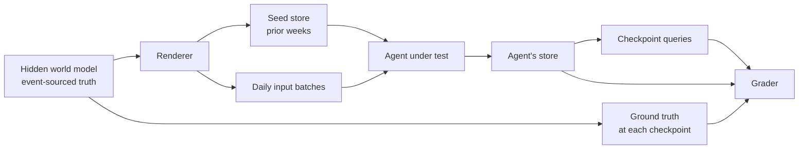

# Benchmark design

Status: draft. See [motivation](motivation.md) for why this benchmark exists.

## Overview

white-collar-bench evaluates an agent that maintains a knowledge worker's **store**: a repository of files describing projects, open loops, decisions and people. The benchmark replays simulated workdays. Each day the agent ingests new material. At set checkpoints it answers questions about the current state of the world. Answers are graded against a hidden, authoritative world model.

Two task types:

1. **Ingestion:** incorporate new inputs (email, chat, meeting transcripts, documents, the worker's own notes) into the store.
2. **State-of-the-world queries:** answer questions such as "What is the status of Project Thistledown?", "What do I owe Marisol?" or "What does Marisol owe me?"

Later answers depend on earlier ingestion, so errors compound as they would in real use.

## Architecture

### World model

The generator owns a timeline of typed facts that is never shown to the agent:

- **Entities:** the worker, people, organizations, projects.
- **Facts with validity intervals:** roles, project status, owners, deadlines and relationships, each true from time `t1` until superseded.
- **Commitments:** who owes what to whom, with a creation time, due date and resolution (done, dropped or transferred).
- **Decisions:** what was decided, by whom, and when, including later reversals.
- **Events:** meetings, messages and documents, each linked to the facts it creates, changes or provides evidence for.

Because the model is event-sourced, the true state at any time `T` can be computed. That gives ground truth for any checkpoint without hand labelling.

### Renderer

The renderer turns world events into realistic artifacts. It controls how facts are expressed:

- **Direct:** "We've agreed to ship on 14 March."
- **Indirect:** a calendar change, or a reply that implies agreement.
- **Noisy:** irrelevant threads, newsletters, small talk, off-topic transcript sections.
- **Redundant:** the same fact repeated across channels.
- **Conflicting:** later messages that supersede earlier ones, or that contradict each other for a while.

Each rendered artifact records which world facts it carries. This lets the grader tell an ingestion miss (the input carried the fact and the store lacks it) apart from an unobservable fact.

Every entity and detail is synthetic. See [AGENTS.md](../AGENTS.md).

## Episodes

An **episode** is one synthetic world played over a period of time.

- **Seed store:** the episode starts with an established store covering several weeks of prior history, in a correct, contract-compliant state. Real use involves working within existing state, not starting from nothing.
- **Workdays:** each simulated day delivers one batch of inputs. The agent runs one ingestion session per day, with the simulated current date provided.
- **Checkpoints:** query sets run at chosen points, for example end of Tuesday, end of Thursday and end of the week.
- **Length:** one week is the basic unit. Variants of 2, 4 and 8 weeks measure how error builds up over time.
- **Isolation:** each ingestion session and each query session runs as a fresh agent invocation. The store is the agent's only memory between sessions, unless a track explicitly allows otherwise.

### Planted challenges

Each episode deliberately includes:

| Challenge | Example |
|---|---|
| Supersession | A launch date set on Monday moves on Wednesday. |
| Reversal | A decision is made and later undone. |
| Aliases | "Marisol", "M. Teague", "mteague@…", "the new PM" are one person. |
| Name collisions | Two different people named Sam. |
| New entities | A new collaborator or project appears without introduction. |
| Duplicate signals | The same ask arrives by email and in a meeting. |
| Implied commitments | "Let me take a look" creates a loop owned by the worker. |
| Weak evidence | A scheduled meeting has no notes or follow-up showing it happened. |
| Transfers | Ownership of a task moves from one person to another. |
| Silent closure | A loop is resolved only by an indirect signal. |
| Noise | Newsletters, social chatter, unrelated threads. |
| Unobservable facts | A world fact never appears in any input; questions about it should be abstained from. |

## Query taxonomy

| Type | Example | Expected answer |
|---|---|---|
| Point fact | Who owns the vendor contract on Thistledown? | Entity |
| List | What do I owe Marisol? What does Marisol owe me? | Set of loops |
| Status | What is the status of Thistledown? | Structured summary |
| Relationship brief | What am I working on with Marisol? | Projects and loops |
| Change | What changed on Thistledown since Monday? | Set of changes |
| Temporal | When did we decide to drop the beta? | Date or event |
| Prioritization | What should I focus on tomorrow? | Ranked loops |
| Unanswerable | What is Thistledown's budget? | Abstain |

### Answer format

Answers use a fixed structure so grading is tractable:

- Structured fields for each query type, such as entity IDs, loop sets, dates, or summary items.
- **Citations** for each claim: store record paths and source artifact IDs.
- An explicit abstention or uncertainty flag when the evidence is insufficient.

Structured fields are graded deterministically. Free-text summaries are graded with rubrics (see Grading).

## Tracks

### Track A: specified contract (primary)

The benchmark supplies a store contract written for the benchmark. It is generic and synthetic, not derived from any private store's instructions. It covers:

- **Record types and fields:** projects, loops (tasks, asks, decisions), people and logs, with required metadata such as status, owner, counterparty, due date and evidence.
- **Boundaries:** current state lives in exactly one canonical record; logs are append-only and reference records by ID.
- **Linking and identity:** stable IDs, alias lists, and rules for when to create an entity versus merge into an existing one.
- **Evidence:** status changes cite a source; calendar entries alone do not prove completion.
- **Privacy:** what must never be stored, such as credentials and meeting join links.

The contract says **what** the store must satisfy, not **how** to work. The agent chooses its own procedure.

Track A supports direct inspection of the store, attributing errors to ingestion or synthesis, and comparing models in identical conditions.

### Track B: open representation

The agent starts from the seed inputs as raw artifacts in an otherwise empty workspace, with a short statement of goals and no schema. It may organize memory however it likes. It is graded **only through query answers**.

Track B compares agent architectures and memory systems, and shows whether a model develops a useful structure unprompted. Its results are harder to diagnose.

## Grading

### Query grading

- **Deterministic:** precision and recall over loop sets and change sets; exact match on entities and dates; correct abstention.
- **Citations:** each cited source must exist and support the claim. Unsupported claims are penalized.
- **Rubric-based:** status summaries and briefs are graded for currency, completeness, prioritization, faithfulness and honest uncertainty, by an LLM judge working from a checklist derived from the world model. Judge agreement is validated against human grades on a sample.

### Store grading (Track A)

After each ingestion day, the store is checked against the contract and the world model:

- **Contract validity:** schema, required fields, link integrity, privacy rules.
- **Entity integrity:** duplicate records (one real entity, several records), wrong merges (two entities, one record), unresolved aliases.
- **State accuracy:** status, owner and due date compared with the world model at that date; stale records counted.
- **Coverage:** observable facts and commitments that are missing.
- **Hallucination:** records or claims that no input supports.
- **Evidence:** status changes without valid citations.

### Error attribution

Each checkpoint's queries run twice:

1. **End-to-end:** against the agent's own store.
2. **Oracle store:** against a correct store supplied by the benchmark for that date.

Oracle-store scores measure synthesis alone. The gap between the two scores measures the cost of ingestion errors. Track B has no oracle-store run.

### Efficiency

Tokens, wall time, tool calls and cost are reported for each ingestion day and each query session, so quality can be weighed against cost.

## Reporting

- Headline: end-to-end query score per track, averaged over episodes.
- Breakdown by query type, planted challenge and checkpoint position, including how scores change with episode length.
- Track A: store-integrity metrics, oracle-store score and the gap between them.
- Variance across repeated runs with different seeds.

## Open questions

- How large should a world be (people, projects, inputs per day) to be realistic but affordable?
- How much should the generator be steered for difficulty, and how should difficulty tiers be defined?
- Should agents get tools beyond the file system, such as search or a simulated inbox API?
- Should a later day ever correct an earlier input, so the agent must revise past entries?
- How can the benchmark resist overfitting if episodes are public? Options include held-out worlds and new seeds for each release.
- How often should LLM-judge rubrics be checked against human grades?
