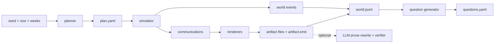

# World generator

Status: v1 design. Builds on [design](design.md), [plan](plan.md#4-generation-pipeline) and [formats](formats.md).

The generator produces complete worlds — `world.yaml`, `world.jsonl`, inbox artifacts and `questions.yaml` — from a seed. `wcb world build` then derives gold exactly as for a hand-authored world, so generated and hand-authored worlds are graded identically.

```bash
wcb generate --seed 7 --weeks 1 --size standard --out worlds/dev/gen-s7-w1
wcb world build worlds/dev/gen-s7-w1
```

Generation is deterministic: the same seed, parameters and generator version produce byte-identical output. Optional LLM rewriting (`--llm`) is the one exception and is cached.

## Pipeline



| Stage | Module | Output |
|---|---|---|
| Planner | `wcb/world/planner.py`, `names.py`, `archetypes.py` | `plan.yaml`: setting, cast, orgs, projects with archetypes and sizes, calendar, scheduled planted challenges |
| Simulator | `wcb/world/simulator.py` | World events (`entity.create`, `fact.set`, `commitment.*`, `decision.*`, `project.*`) and **communications** |
| Renderers | `wcb/render/{email,chat,transcript,notes,calendar,documents}.py` | Artifact files and `artifact.emit` events |
| Question generator | `wcb/questions/generate.py` | `questions.yaml` |
| Orchestration | `wcb/world/generate.py` | A world directory ready for `wcb world build` |

## Planner

The planner samples a synthetic organization and portfolio. Everything comes from the seed.

- **Setting.** One of several organization templates, for example a university system, a regional hospital network's shared-services office, a mid-size manufacturer's digital office, a city government's digital service, or a nonprofit federation. Each template defines a central team and several semi-autonomous units, plus vendors, partners and minor senders. Units have different receptiveness.
- **Names.** People are drawn from large, diverse first-name and surname pools, combined at random and checked against a denylist of famous people and the names used as examples in the docs. Organization, product and project names are coined from syllables and word lists, with an `.example` domain. Every core person gets 3–6 surface forms: first name, full name, initial plus surname, email, chat handle, sometimes a nickname, and a role phrase. Planned first-name collisions are created deliberately.
- **Portfolio.** Project count follows the size: small has 6–8 projects, standard 10–14 and large 16–20. Size classes are heavy-tailed: one flagship, one hub, several mid-size projects, and small, placeholder and dormant ones. Each project gets an archetype, an owner, a sponsor, members (2–15, heavy-tailed) and orgs.
- **Calendar.** Two seed weeks, then `weeks` episode weeks of Monday to Friday plus an optional light Saturday. Checkpoints fall on Tuesday, Thursday and the end of each week.
- **Planted challenges.** A schedule guarantees that every challenge tag in [formats](formats.md#14-planted-challenge-tags) appears at least once per episode week, distributed across projects and days.

## Archetypes

An archetype is a small state machine over project **phases**. Each phase defines:

- the probability per business day of moving to each next phase;
- **beats**: event bundles fired on entry or at random while in the phase, for example "questionnaire sent: the worker asks the vendor's sales engineer to return a security questionnaire, due in 5–10 days";
- the channels and meeting types typical of the phase.

The library implements the abstract shapes in [plan §1](plan.md#how-projects-evolve) and the [calibration notes](calibration.md):

- flagship pilot build with gates
- unit discovery
- pivoting discovery that splits
- background advisory that fades
- portfolio-wide supplier negotiation
- event preparation that spawns a successor
- internal product incubation
- economics model
- shared-platform blocker hub
- strategic framework
- hiring pipeline
- education programme
- placeholder
- stalled discovery
- vendor-pair evaluation
- operational incident
- peer review exchange
- relationship thread
- delegated asks

Beat text uses slot templates such as `Send {person.first} the revised {artifact_noun} for {project.short}`. Each beat names the keywords that renderers must include verbatim.

## Simulator

The simulator steps day by day from the seed start to the last episode day. On each business day:

1. Each active project draws phase transitions and beats.
2. Each beat creates or updates world events: commitments, project facts, decisions, splits and merges.
3. Open commitments progress according to calibrated lifetimes. Lifetimes are bimodal: many close within 0–2 days, a long tail stays waiting for weeks. Transitions follow the observed mix (see [calibration](calibration.md)): open → done, waiting → done, open ↔ waiting, drops, transfers, a rare reopen, and due-date supersessions.
4. Each change is attached to one or more **communications** that reveal it. Some changes are deliberately revealed late, more than once (duplicate signal), only indirectly (silent closure) or never (weak evidence, unobservable).
5. Noise communications are added: newsletters, notifications and unrelated threads. On a typical day about half of email is noise.

A **communication** is the intermediate unit that renderers turn into files:

```json
{"id": "cm-0042", "t": "2027-03-02T10:15:00-08:00", "channel": "email",
 "kind": "email", "sender": "p-...", "to": ["p-..."], "cc": [], "participants": [],
 "project": "pr-...", "thread": "th-0007", "subject": "Re: data-sharing agreement",
 "acts": [{"event": "e-0193", "how": "direct"}, {"event": "e-0194", "how": "hedged"}],
 "noise": false, "draft": false, "secrets": [], "received_at": "2027-03-02T10:15:00-08:00",
 "artifacts": ["em-0031"], "challenges": ["implied_commitment"]}
```

`kind` is one of: `email`, `chat_dm`, `chat_channel`, `meeting`, `document`, `note`, `voice_memo`, `calendar_invite`, `calendar_update`, `calendar_cancel` or `calendar_reply`. A meeting communication produces a transcript, notes or both according to the coverage mix: about 55% full transcript, 25% recap only and 15% worker debrief only.

Each act has a `how`, which controls the phrasing:

| `how` | Meaning |
|---|---|
| `direct` | States it plainly. |
| `hedged` | Expresses it as an intention, for example "I can try to…". |
| `implied` | Conveys it only through a related statement, for example "let me take a look". |
| `indirect` | Shows it only through a side effect, for example "I'm in the sandbox now, thanks". |
| `second_hand` | Someone else reports it. |
| `correction` | Corrects an earlier statement. |

## Renderers

Renderers are deterministic templates seeded per communication. Each one draws on phrase banks for each event type and each `how`, plus a few voices per person: formal, terse, chatty or lowercase. They also add realistic texture:

- **Email:** greetings, sign-offs and signatures with titles, quoted reply chains, forwards, CC lists and `X-Draft: true` drafts.
- **Chat:** lowercase terse messages, threads, reactions, and edits that change a fact (`"edited": true`, with the earlier text kept in `"original"`).
- **Transcripts:** small talk, backchannels, cut-offs, a missing opening, speaker-label drift and mangled names.
- **Notes:** AI-recap style with a confidently wrong line, or the worker's terse shorthand.
- **Calendar:** invites with planted join-link secrets.
- **Documents:** versioned `.docx`, `.pdf` and `.md` files, and `.xlsx` scorecards and cost models, through [`wcb/render/office.py`](../wcb/render/office.py).

Every rendered artifact must contain the keywords of the commitments and decisions it reveals. The renderer checks this and the world check verifies it.

### Optional LLM rewrite

With `--llm --llm-model <spec>`, using a model spec as in [judge](judge.md), each non-noise artifact's prose is rewritten for naturalness under constraints:

- keep headers and structure;
- keep every keyword and fact;
- add no new commitments, dates or decisions.

A verifier call then extracts facts from the rewrite. If keywords are missing or extra commitments appear, the template version is kept. Results are cached under `.wcb-cache/` and keyed by prompt hash.

## Question generator

The question generator produces `questions.yaml` for every checkpoint from the gold states. It:

- covers every template;
- prefers entities touched by planted challenges;
- uses aliases in about 30% of entity mentions;
- makes about 10% of questions unanswerable through unobservable facts;
- includes per-person ledgers, a flagship status, a change question since the previous checkpoint and a prioritization question at every checkpoint.

## Validation

`wcb generate` runs `wcb world check` on its output and fails on any error. `wcb world stats` compares the generated world with the calibration targets. The generator's test suite asserts determinism, target tolerances and full challenge coverage across a sample of seeds.
