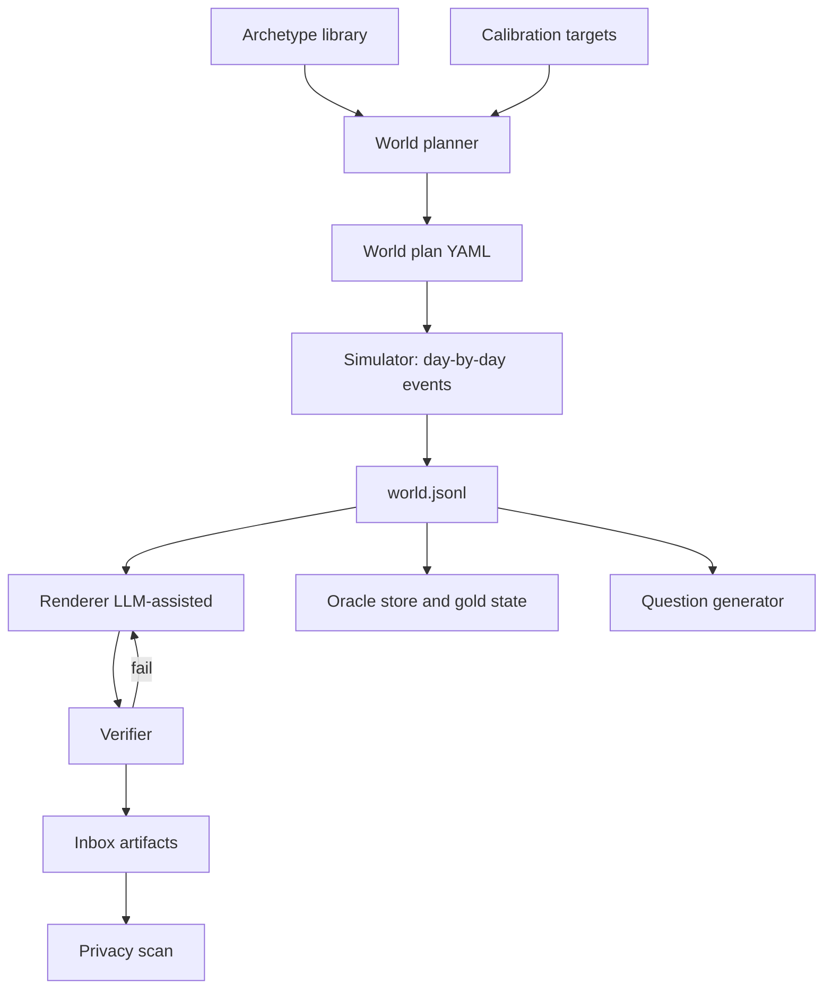

# Construction plan

Status: draft. Builds on [design](design.md); scoring and the run protocol are in [scoring](scoring.md).

## Principles

- **Patterns in, content never.** The benchmark is calibrated against the structure and dynamics of a real, private knowledge store. Only aggregate statistics and abstract patterns cross over. No names, organizations, products, quotations, dates of real events or distinctive details are copied, paraphrased or disguised. See [AGENTS.md](../AGENTS.md).
- **Ground truth is what an ideal ingestor could know.** Gold answers come from the world model restricted to facts revealed by inputs delivered so far, not from the full hidden truth.
- **Build a small hand-made world first.** A hand-authored pilot world proves the end-to-end loop (inputs, harness, gold, grading) before any generator is written.
- **Everything is versioned and reproducible.** Worlds, prompts, judge models and grader code are pinned per release.

## 1. What the real store teaches

A pattern-level review of a private knowledge store, about 10 weeks old and maintained daily by an agent, produced the following. Figures are rounded aggregates.

### Scale and flow

| Quantity | Observed (rounded) | Benchmark target for a standard world |
|---|---|---|
| Projects | ~20; heavy-tailed, the top two hold ~35% of loops | 10–14; 2 dominant, 4–6 mid-size, a few small or dormant |
| People | ~100 dossiers; ~15 in frequent contact | 35–50; 12–15 core |
| Loops created | ~550 in 10 weeks (~7 per workday) | 5–9 per workday |
| Meeting artifacts | ~6 files per meeting day | 2–5 meetings per day |
| Input formats | Markdown notes, plain-text and VTT transcripts, JSON chat exports, DOCX, PDF, PPTX, XLSX, images | All of these, weighted toward email, chat and transcripts |
| Weekend activity | Lighter but nonzero | Optional light Saturday batch |

### Loop shape

| Field | Observed distribution (rounded) |
|---|---|
| Kind | task 56%, ask 41%, decision 3% |
| Owner | worker 45%, others 45%, joint 7% |
| Status at a snapshot | done 42%, waiting 28%, open 26%, dropped 4%, blocked 1% |
| Evidence basis | reported 47%, received 31%, sent 19%, scheduled 2%, inferred or suggested <1% |
| Agent-suggested (not yet endorsed) | 11% |
| People per loop | mostly 1–3 |
| Hard due date | ~8% |
| Lifetime of closed loops | median 1 day, p75 6 days, p90 15 days |
| Log entries per loop | median 2, p90 8 |

### Status dynamics

- The most common transitions are open → done and waiting → done. Open → waiting, waiting → open, and drops from open or waiting each happen at roughly a tenth of that rate.
- Most loops change status once. A few flip 3–5 times.
- Reopening a closed loop is rare (<1%) but does happen.
- Project logs range from 1 to over 200 entries. Projects keep a single current-state paragraph, superseded states move to the dated log, and long-lived knowledge is kept apart from current status.

### How projects evolve

These archetypes describe abstract shapes. Synthetic projects will instantiate them with invented content.

1. **Vendor diligence that stalls.** Enthusiasm, a requested deep dive, no dated follow-up, a slide to dormant, sometimes revived by an outside event.
2. **Competitive vendor selection.** Questionnaires, demos, a parallel procurement thread, an internal stakeholder raising a handoff concern, alternatives explored, decision criteria shifting.
3. **Internal architecture or reference-design programme.** Drafts v1 → v3, several review rounds, the worker endorsing one option, circulation to leadership, a sub-programme split into its own project.
4. **Peer review exchange.** The worker reviews a colleague's document, sends feedback, the colleague revises, and a follow-up sync is promised.
5. **Operational incident.** A standup cadence, an owner change, a postmortem ask.
6. **Recurring programme.** Talks or training with scheduling, speakers and attendance.
7. **Relationship thread.** Introductions, catch-ups and favours across projects.
8. **Delegated asks.** The worker asks someone for input; it waits, gets chased, then arrives or is dropped.

### Recurring hard cases

These go into the planted-challenge catalogue in [design](design.md#planted-challenges):

- **Draft vs sent.** A draft reply exists, but only one of two drafted messages was actually sent.
- **Acceptance vs occurrence.** An accepted calendar invite is not evidence that the meeting happened or produced an outcome.
- **Corrections.** A later message corrects an earlier mistaken account, for example "actually that was delivered on the 1st."
- **Restructuring.** One project splits into two, or two merge; loops must move.
- **Endorsement.** A suggested loop becomes an accepted commitment only when the worker endorses it.
- **Worker directives.** The worker's own notes or chat ("yes, go with option 1") are inputs that change state.
- **Version mismatch.** An attachment differs from the version described in the email body.
- **Batch catch-up.** Several days of inputs arrive at once after a gap, with ordering cues only in timestamps.
- **Scattered evidence.** A single loop's resolution is spread across email, chat and a transcript.

### Store contract

The real store's contract (one canonical state record per thing, append-only logs, knowledge apart from state, an evidence badge on every loop, and endorsement flags) works well and matches Track A's needs. The benchmark's contract will be **written fresh**, with generic field names and no tooling dependencies. It will not reuse the source text.

## 2. Repository layout

```text
white-collar-bench/
  contract/            Track A store contract, JSON Schemas, validator
  wcb/                 Python package
    world/             world-model types, archetypes, planner, simulator
    render/            artifact renderers (email, chat, transcript, doc, note)
    store/             seed and oracle store renderer (contract format)
    questions/         question templates and generator
    runner/            episode runner and adapter protocol
    grade/             deterministic graders, judge, store-integrity checks
    privacy/           leak scanner
  worlds/
    pilot/             hand-authored world (public)
    dev/               generated worlds with gold (public)
    test/              manifests only; content held privately
  adapters/examples/   reference adapters
  docs/
```

## 3. Data model

### World model (hidden)

An event-sourced log in `world.jsonl`. Every record has an `id`, `t` (timestamp) and `type`:

- `entity.create`: person, organization or project, with canonical name and **surface forms** (nicknames, email handle, role phrases).
- `fact.set`: `{subject, attribute, value, valid_from}`. Supersedes earlier values.
- `commitment.create / .update / .resolve`: `{debtor, creditor, what, due, status, kind, accepted}`.
- `decision.make / .reverse`.
- `project.split / .merge`.
- `artifact.emit`: `{artifact_id, channel, reveals: [fact or commitment ids], noise: bool}`.

**Knowability rule:** a fact is knowable at time `T` if an artifact delivered at or before `T` reveals it. Gold state at `T` is the latest knowable value of each attribute. Facts never revealed are **unobservable** and are used for abstention questions.

### Inputs (visible)

```text
inbox/2027-03-02/
  manifest.json          [{id, channel, received_at, path}]
  em-0193.eml
  ch-0412.json           chat thread export
  mt-0057.vtt            meeting transcript
  mt-0057-notes.md       meeting notes (sometimes missing)
  dc-0021.docx
  nt-0088.md             worker's own note or directive
```

Artifact IDs are stable and serve as citation keys.

### Gold (hidden)

- `gold/state/<date>.json`: knowable state per day (entities, loops, project status).
- `gold/oracle-store/<date>/`: a correct Track A store for that day.
- `gold/questions/<checkpoint>.json`: questions with gold answers, supporting artifact IDs and rubric checklists.

## 4. Generation pipeline



1. **World planner.** Samples a synthetic organization, cast and project portfolio from the archetypes and calibration targets. Output is a reviewable YAML plan: people, roles and aliases, projects with archetype and arc, and the planted challenges to schedule.
2. **Simulator.** Steps day by day, firing archetype transitions (stochastic with a fixed seed) to produce commitments, status changes, decisions and meetings. It enforces the calibration distributions in §1.
3. **Renderer.** Turns each event into one or more artifacts. A model writes prose under tight constraints (who, what, which facts to reveal, register, noise level). Templates handle structured formats (EML headers, VTT timing, chat JSON). Noise artifacts are generated separately.
4. **Verifier.** For each artifact, a separate model call extracts facts and compares them with the intended `reveals` list. Missing or extra facts trigger a re-render. This keeps gold faithful to the inputs.
5. **Seed and oracle store renderer.** Deterministically writes contract-format stores from gold state: the seed store at episode start and an oracle store for each day.
6. **Question generator.** Templates over gold state at each checkpoint (see [design](design.md#query-taxonomy)), with a slot filler that prefers entities touched by planted challenges. Includes about 10% unanswerable questions. Gold answers and rubric checklists are derived mechanically.
7. **Privacy scan.** See §6.

## 5. Milestones

| # | Milestone | Deliverables | Exit criteria |
|---|---|---|---|
| M0 | Specs | Track A contract v0, world/artifact/question/answer schemas, adapter protocol | Contract validator runs on a hand-written sample store |
| M1 | Pilot world | Hand-authored 1-week world: 5 projects, 15 people, ~60 artifacts, 3 checkpoints, ~40 questions | Gold produced by hand; reviewed for realism |
| M2 | Runner and grader v0 | `wcb run`, `wcb score`; deterministic graders; store-integrity checks | Null, raw-retrieval and oracle baselines score as expected on the pilot (§7) |
| M3 | Generator v1 | Planner, simulator, renderer, verifier, oracle store, question generator | Generated worlds match the calibration targets within tolerance; verifier pass rate >95% |
| M4 | Judge and calibration | Rubric judge, human-grading sample, judge agreement study | Judge–human agreement κ ≥ 0.8 on matching and coverage decisions |
| M5 | Dev release | 10 dev worlds (1-, 2- and 4-week), public gold, reference adapters, baseline results | Reproducible scores (±1 point across reruns of grading) |
| M6 | Test set and leaderboard | Private test worlds, submission flow, metered runs | First external submission scored |

## 6. Privacy safeguards

- **Authoring.** Generator prompts contain only archetypes, synthetic plans and calibration numbers. They never contain private-store text.
- **Leak scanner.** `wcb privacy scan --private-repo <path> <corpus>` extracts proper nouns, email domains and distinctive multi-word phrases from a local private repository at run time. It reports any overlap with generated content. The private term list is held in memory and never written to this repository.
- **Name generation.** Names come from a synthetic generator with a denylist check. Organizations use invented names, not real-company lookalikes.
- **Release gate.** Every release requires a clean scan plus a manual skim of a random sample of artifacts.

## 7. Baselines

| Baseline | Purpose | Expected |
|---|---|---|
| Null (always abstain) | Floor | Scores only on unanswerable questions (~10%) |
| Raw retrieval (archives inputs, no curation; answers by search) | Shows the value of curation | Moderate on point facts; weak on status, change and stale-state questions |
| Oracle store + reference model | Synthesis ceiling for that model | Upper bound for Track A end-to-end |
| Reference CLI agents with frontier models | First leaderboard rows | — |

## 8. Risks

| Risk | Mitigation |
|---|---|
| Generated worlds feel artificial | Archetypes drawn from real dynamics; realism review of each release by a practitioner |
| Gold drifts from what the inputs actually say | Verifier loop; knowability rule; spot audits |
| LLM judge bias toward a model family | Pinned judge from a different family than the leading entrants; matching decisions kept narrow and structured; human-agreement checks |
| Overfitting to public worlds | Private test split; fresh seeds per release |
| Cost of long episodes | Standard tier is 1 week; long tiers sampled less often |
| Contract favours one harness style | Contract specifies outcomes, not procedure; Track B removes it entirely |
