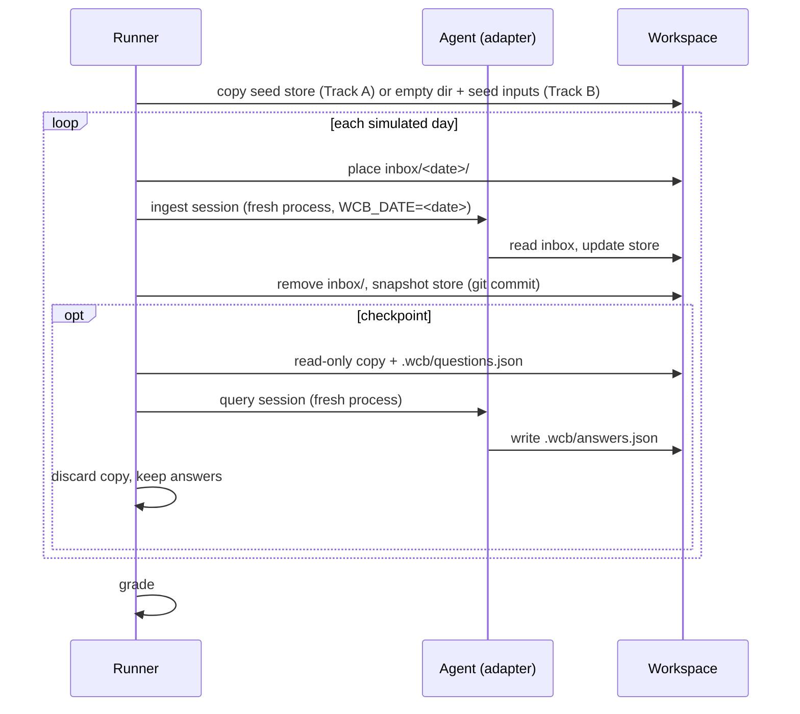

# Scoring and run protocol

Status: draft. See [design](design.md) for task structure and [plan](plan.md) for construction.

## How to run the benchmark

A competitor supplies an **adapter**: a small config that tells the runner how to invoke their agent and harness. The runner owns the episode loop, the workspace, the clock and the grading. The agent only ever sees the workspace.

### 1. Install and fetch worlds

```bash
pip install white-collar-bench
wcb fetch dev            # public dev worlds with gold
```

### 2. Write an adapter

```yaml
# adapter.yaml
name: my-agent
version: 0.3.1
model: provider/model-name        # reported on the leaderboard
ingest:
  cmd: ["my-agent", "run", "--cwd", "{workspace}", "--prompt-file", "{prompt}"]
  timeout_s: 1800
query:
  cmd: ["my-agent", "run", "--cwd", "{workspace}", "--prompt-file", "{prompt}"]
  timeout_s: 900
env_passthrough: [MY_PROVIDER_API_KEY]
```

The runner fills in `{workspace}` and `{prompt}`. The prompt is a file of fixed benchmark text. Adapters may wrap it with their own system prompt, but must not add knowledge specific to a world.

### 3. Run and score

```bash
wcb run   --adapter adapter.yaml --split dev --track A --repeats 3 --out runs/my-agent
wcb score runs/my-agent            # writes report.json and report.md
```

For the leaderboard, submit a container image plus `adapter.yaml`. Maintainers run it on the private test split (see [Submission](#submission-and-verification)).

## Episode protocol



Rules:

- **Fresh process per session.** No memory carries over outside the workspace. On the leaderboard, each session runs in a new container.
- **Inbox is drained.** Inputs are available only during their ingestion session. The agent may archive copies inside the store. Raw archiving followed by search at query time is a legitimate strategy; Track A's store grading measures whether curation also happened.
- **Query sessions are read-only.** The runner discards any changes made to the store.
- **Clock.** `WCB_DATE` and the prompt give the simulated date. The agent must treat it as "today".
- **No outside data.** The network is limited to model endpoints. Gold and world files are never mounted.
- **Budgets.** Each session has a wall-clock timeout. Timeouts and crashes leave the store as it was (ingestion) or count as empty answers (query).

### Standard prompts

**Ingestion:**

> Today is {date}. New inputs are in `inbox/{date}/` (see `manifest.json`). Incorporate them into the store following `CONTRACT.md`. Inputs will not be available after this session.

**Query:**

> Today is {date}. Answer every question in `.wcb/questions.json` using the store. Write `.wcb/answers.json` following `.wcb/answer-schema.json`. Cite sources. Abstain when the store does not support an answer. Do not modify the store.

In Track B, `CONTRACT.md` is replaced by a one-paragraph goal statement.

## Answer format

```json
{
  "q-0412": {
    "type": "list",
    "abstain": false,
    "items": [
      {
        "text": "Send Dana the revised vendor scorecard",
        "counterparty": "Marisol Teague",
        "direction": "i_owe",
        "status": "open",
        "due": "2027-03-05",
        "cites": ["em-0193", "loops/send-dana-vendor-scorecard.md"]
      }
    ]
  },
  "q-0413": {
    "type": "status",
    "abstain": false,
    "summary": "Thistledown is waiting on Brenwick's security questionnaire...",
    "claims": [
      {"text": "Vendor shortlist cut to two on 3 Mar", "cites": ["mt-0057"]}
    ]
  },
  "q-0414": {"type": "point", "abstain": true}
}
```

Each type has a JSON Schema in `contract/answers/`. Answers that fail validation score 0.

## Query scoring

Each question scores between 0 and 1.

| Type | Score |
|---|---|
| **Point fact** | 1 if the answer resolves to the gold entity or value, using the world's alias table and normalized dates or numbers; otherwise 0. |
| **List** (owes, owed, open loops) | Soft F1. Predicted items are matched to gold items one-to-one (see Matching). Each match earns attribute credit `a` = fraction correct of status, due date and counterparty. Soft precision = Σa / predicted; soft recall = Σa / gold. |
| **Status / relationship brief** | Checklist coverage. Gold has weighted checklist items (current status, latest change, blockers, open asks with owners, next dated step; critical items weigh 2, others 1). Judge marks each item *covered*, *missing* or *contradicted*. Score = max(0, (Σw·covered − Σw·contradicted) / Σw). Presenting a superseded fact as current counts as contradicted. |
| **Change since T** | F1 over gold change events (status changes, new or closed loops, decisions) between T and now. |
| **Temporal** | 1 for the exact date or event; 0.5 within one business day; otherwise 0. |
| **Prioritization** | Recall of the gold must-include set (overdue or due-next-day items owned by the worker) in the top k, multiplied by (1 − share of listed items that are closed or not the worker's). |
| **Unanswerable** | 1 for abstaining; 0 for any substantive answer. |

**Abstention on answerable questions scores 0.** There is no partial credit for hedging.

### Citations

Each claim or item cites artifact IDs and, in Track A, store paths. Citation precision `c` is the fraction of citations that exist and support the claim. Supporting artifact IDs come from the world model; store paths are judged against the record's content. The final question score is:

```text
q_final = q × (0.75 + 0.25 × c)
```

Missing citations give `c = 0`, which caps the question at 0.75.

### Matching

List and change items are matched to gold in two steps:

1. **Candidates:** gold items sharing a cited artifact or the same counterparty.
2. **Confirmation:** a pinned judge model answers one narrow yes/no question per candidate pair: "Do these describe the same commitment?"

The final one-to-one assignment maximizes confirmed matches. Judge prompts, model, version and temperature (0) are fixed per release. Each decision is the majority of 3 samples.

### Aggregation

```text
checkpoint score  = macro-average over question types present at that checkpoint
episode score     = mean over checkpoints
WCB score (track) = 100 × mean over episodes and repeats
```

Macro-averaging by type prevents list questions, which are numerous, from dominating. Reports include 95% bootstrap confidence intervals over episodes. Two entries whose intervals overlap are reported as tied.

## Store integrity (Track A)

After every ingestion day `d`, the store is compared with the knowable gold state `G_d`.

| Metric | Definition |
|---|---|
| **Entity F1** | People and project records mapped to world entities via names and aliases (judge for ambiguous cases). A duplicate record counts as a false positive; a wrongly merged record counts as a false negative for the entity it absorbed. |
| **Loop F1** | Loop records matched to knowable commitments, using the same matching as list questions. |
| **Field accuracy** | On matched loops: status, owner direction, counterparty, due date and accepted flag, equally weighted. |
| **Freshness** | 1 − share of matched loops and projects whose state reflects a superseded fact. |
| **Groundedness** | 1 − share of records or claims that no delivered artifact supports. |
| **Validity** | 1 − min(1, contract-validator errors / records). |

```text
SIS_d = 100 × mean(Entity F1, Loop F1, Field accuracy, Freshness, Groundedness, Validity)
SIS   = mean of SIS_d over days; final-day SIS reported separately
```

## Error attribution (Track A)

Each checkpoint's questions also run against the oracle store for that date, in a separate query session with the same adapter.

```text
Synthesis score  = WCB score on oracle stores
Ingestion cost   = Synthesis score − WCB score (end-to-end)
```

A small ingestion cost means the agent kept the store about as good as a perfect one. The report also shows each checkpoint's score against episode day, so error growth over time is visible.

## Efficiency

The runner records wall time and tool or command counts. Token use and cost come from either:

- **Metered mode:** model calls go through the runner's proxy (`WCB_LLM_BASE_URL`). This is required for a *verified* leaderboard badge.
- **Self-reported mode:** the adapter writes `.wcb/usage.json` after each session.

Reported per simulated day of ingestion and per checkpoint of querying, alongside a cost-versus-score plot.

## Report

`wcb score` produces:

- **Headline:** WCB score (Track A and/or B), with confidence interval.
- **Track A:** SIS, Synthesis score, Ingestion cost.
- **Breakdowns:** by question type, planted challenge, checkpoint position and episode length.
- **Efficiency:** tokens, cost and time per simulated day.
- **Failure samples:** worst-scoring questions with gold and predicted answers, for debugging on dev worlds only.

## Submission and verification

1. Develop against the `dev` split, which includes gold, locally.
2. Submit a container image, `adapter.yaml` and model identifiers.
3. Maintainers run Track A and/or B on the private `test` split: 3 repeats, metered mode, fresh container per session.
4. Results are published with the harness version, model, date and cost. Test worlds are refreshed each release, and older results are marked with their release.

## Validating the scoring

Before release, the scoring must show:

- **Ordering:** null baseline < raw retrieval < reference agents < oracle-store ceiling on dev.
- **Sensitivity:** deliberately corrupted stores (duplicated person, stale status, dropped loop) lower SIS and the scores on dependent questions.
- **Judge agreement:** κ ≥ 0.8 with human graders on matching and coverage decisions.
- **Stability:** re-grading identical answers changes scores by less than 1 point.
