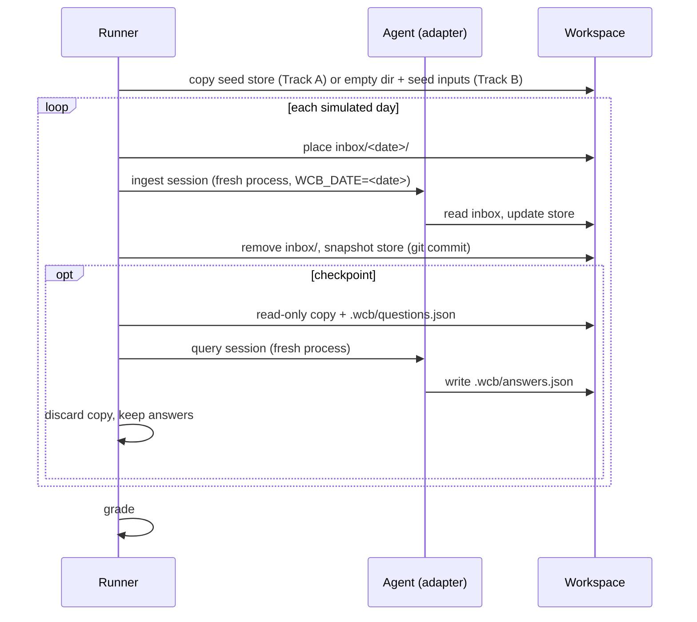

# Scoring and run protocol

Status: draft. See [design](design.md) for task structure and [plan](plan.md) for construction.

## How to run the benchmark

A competitor supplies an **adapter**: a small config that tells the runner how to invoke their agent and harness. The runner owns the episode loop, the workspace, the clock and the grading. The agent only ever sees the workspace.

### 1. Install and fetch worlds

```bash
git clone <this repository> && cd white-collar-bench
uv venv && uv pip install -e .     # or: pip install -e .
wcb world list                     # the pilot and dev worlds ship in worlds/, with gold
```

### 2. Write an adapter

```yaml
# adapter.yaml
name: my-agent
version: 0.3.1
model: provider/model-name        # reported on the leaderboard
ingest:
  cmd: ["my-agent", "run", "--cwd", "{workspace}", "--prompt-file", "{prompt}"]
  timeout_s: 1800
query:
  cmd: ["my-agent", "run", "--cwd", "{workspace}", "--prompt-file", "{prompt}"]
  timeout_s: 900
env_passthrough: [MY_PROVIDER_API_KEY]
```

The runner fills in `{workspace}` and `{prompt}`. The prompt is a file of fixed benchmark text. Adapters may wrap it with their own system prompt, but must not add knowledge specific to a world.

### 3. Run and score

```bash
wcb run   --adapter adapter.yaml --split dev --track A --repeats 3 --out runs/my-agent
wcb score runs/my-agent            # writes report.json and report.md
```

For the leaderboard, submit a container image plus `adapter.yaml`. Maintainers run it on the private test split (see [Submission](#submission-and-verification)).

## Episode protocol



Rules:

- **Fresh process per session.** No memory carries over outside the workspace. On the leaderboard, each session runs in a new container.
- **Inbox is drained.** Inputs are available only during their ingestion session. The agent may archive copies inside the store. Raw archiving followed by search at query time is a legitimate strategy; Track A's store grading measures whether curation also happened.
- **Query sessions are read-only.** The runner discards any changes made to the store.
- **Clock.** `WCB_DATE` and the prompt give the simulated date. The agent must treat it as "today".
- **No outside data.** The network is limited to model endpoints. Gold and world files are never mounted.
- **Budgets.** Each session has a wall-clock timeout. Timeouts and crashes leave the store as it was (ingestion) or count as empty answers (query).

### Standard prompts

**Ingestion:**

> Today is {date}. New inputs are in `inbox/{date}/` (see `manifest.json`). Incorporate them into the store following `CONTRACT.md`. Inputs will not be available after this session.

**Query:**

> Today is {date}. Answer every question in `.wcb/questions.json` using the store. Write `.wcb/answers.json` following `.wcb/answer-schema.json`. Cite sources. Abstain when the store does not support an answer. Do not modify the store.

In Track B, `CONTRACT.md` is replaced by a one-paragraph goal statement, `GOALS.md` (from [`contract/GOALS-TRACK-B.md`](../contract/GOALS-TRACK-B.md)), and the prompts refer to "your files" instead of "the store":

**Track B seed ingestion** (one session before the first episode day, with every seed date's inputs at once):

> Today is {date}. Your inputs so far, up to and including today, are in {inbox_dirs}, one directory per date (each has a `manifest.json`). Incorporate them into your files following `GOALS.md`. Inputs will not be available after this session.

**Track B ingestion:**

> Today is {date}. New inputs are in `inbox/{date}/` (see `manifest.json`). Incorporate them into your files following `GOALS.md`. Inputs will not be available after this session.

**Track B query:**

> Today is {date}. Answer every question in `.wcb/questions.json` using your files. Write `.wcb/answers.json` following `.wcb/answer-schema.json`. Cite sources. Abstain when your files do not support an answer. Do not modify your files.

The texts live in [`wcb/runner/prompts.py`](../wcb/runner/prompts.py).

## Answer format

```json
{
  "q-0412": {
    "type": "list",
    "abstain": false,
    "items": [
      {
        "text": "Send Marisol the revised vendor scorecard",
        "counterparty": "Marisol Teague",
        "direction": "i_owe",
        "status": "open",
        "due": "2027-03-05",
        "cites": ["em-0193", "loops/send-marisol-vendor-scorecard.md"]
      }
    ]
  },
  "q-0413": {
    "type": "status",
    "abstain": false,
    "summary": "Thistledown is waiting on Brenwick's security questionnaire...",
    "claims": [
      {"text": "Vendor shortlist cut to two on 3 Mar", "cites": ["mt-0057"]}
    ]
  },
  "q-0414": {"type": "point", "abstain": true}
}
```

Each type has a JSON Schema in `contract/answers/`. Answers that fail validation score 0.

## Query scoring

Each question scores between 0 and 1.

| Type | Score |
|---|---|
| **Point fact** | 1 if the answer resolves to the gold entity or value, using the world's alias table and normalized dates or numbers; otherwise 0. |
| **List** (owes, owed, open loops) | Soft F1. Predicted items are matched to gold items one-to-one (see Matching). Each match earns attribute credit `a` = fraction correct of status, due date and counterparty. Soft precision = Σa / predicted; soft recall = Σa / gold. |
| **Status / relationship brief** | Checklist coverage. Gold has weighted checklist items (current status, latest change, blockers, open asks with owners, next dated step; critical items weigh 2, others 1). Judge marks each item *covered*, *missing* or *contradicted*. Score = max(0, (Σw·covered − Σw·contradicted) / Σw). Presenting a superseded fact as current counts as contradicted. |
| **Change since T** | F1 over gold change events (status changes, new or closed loops, decisions) between T and now. |
| **Temporal** | 1 for the exact date or event; 0.5 within one business day; otherwise 0. |
| **Prioritization** | Recall of the gold must-include set (overdue or due-next-day items owned by the worker) in the top k, multiplied by (1 − share of listed items that are closed or not the worker's). |
| **Unanswerable** | 1 for abstaining; 0 for any substantive answer. |

**Abstention on answerable questions scores 0.** There is no partial credit for hedging.

### Citations

Each claim or item cites artifact IDs and, in Track A, store paths. Citation precision `c` is the fraction of citations that exist and support the claim. Supporting artifact IDs come from the world model; store paths are judged against the record's content. The final question score is:

```text
q_final = q × (0.75 + 0.25 × c)
```

Missing citations give `c = 0`, which caps the question at 0.75.

### Matching

List and change items are matched to gold in two steps:

1. **Candidates:** gold items sharing a cited artifact or the same counterparty.
2. **Confirmation:** a pinned judge model answers one narrow yes/no question per candidate pair: "Do these describe the same commitment?"

The final one-to-one assignment maximizes confirmed matches. Judge prompts, model, version and temperature are fixed per release: temperature 0 for a single sample, and 1.0 when voting over 3 samples. The default `wcb score` judge is the deterministic heuristic judge; `--judge llm` selects a pinned model. See [judges](judge.md) for prompts, thresholds and model pinning.

### Aggregation

```text
checkpoint score  = macro-average over question types present at that checkpoint
episode score     = mean over checkpoints
WCB score (track) = 100 × mean over episodes and repeats
```

Macro-averaging by type prevents list questions, which are numerous, from dominating. Reports include 95% bootstrap confidence intervals over episodes. Two entries whose intervals overlap are reported as tied.

## Store integrity (Track A)

After every ingestion day `d`, the store is compared with the knowable gold state `G_d`.

| Metric | Definition |
|---|---|
| **Entity F1** | People and project records mapped to world entities via names and aliases (judge for ambiguous cases). A duplicate record counts as a false positive; a wrongly merged record counts as a false negative for the entity it absorbed. |
| **Loop F1** | Loop records matched to knowable commitments, using the same matching as list questions. |
| **Field accuracy** | On matched loops: status, owner direction, counterparty, due date and accepted flag, equally weighted. |
| **Freshness** | 1 − share of matched loops and projects whose state reflects a superseded fact. |
| **Groundedness** | 1 − share of records or claims that no delivered artifact supports. |
| **Validity** | 1 − min(1, contract-validator errors / records). |

```text
SIS_d = 100 × mean(Entity F1, Loop F1, Field accuracy, Freshness, Groundedness, Validity)
SIS   = mean of SIS_d over days; final-day SIS reported separately
```

## Error attribution (Track A)

Each checkpoint's questions also run against the oracle store for that date, in a separate query session with the same adapter.

```text
Synthesis score  = WCB score on oracle stores
Ingestion cost   = Synthesis score − WCB score (end-to-end)
```

A small ingestion cost means the agent kept the store about as good as a perfect one. The report also shows each checkpoint's score against episode day, so error growth over time is visible.

## Efficiency

The runner records wall time and tool or command counts. Token use and cost come from either:

- **Metered mode:** model calls go through the runner's proxy (`wcb run --meter`; see [running](running.md#7a-metered-runs)). This is required for a *verified* leaderboard badge.
- **Self-reported mode:** the adapter writes `.wcb/usage.json` after each session.

Reported per simulated day of ingestion and per checkpoint of querying, alongside a cost-versus-score plot.

## Report

`wcb score` produces:

- **Headline:** WCB score (Track A and/or B), with confidence interval.
- **Track A:** SIS, Synthesis score, Ingestion cost.
- **Breakdowns:** by question type, planted challenge, checkpoint position and episode length.
- **Efficiency:** tokens, cost and time per simulated day.
- **Failure samples:** worst-scoring questions with gold and predicted answers, for debugging on dev worlds only.

## Submission and verification

1. Develop against the `dev` split, which includes gold, locally.
2. Submit a container image, `adapter.yaml` and model identifiers.
3. Maintainers run Track A and/or B on the private `test` split: 3 repeats, metered mode, fresh container per session.
4. Results are published with the harness version, model, date and cost. Test worlds are refreshed each release, and older results are marked with their release.

## Validating the scoring

Before release, the scoring must show:

- **Ordering:** null baseline < raw retrieval < reference agents < oracle-store ceiling on dev.
- **Sensitivity:** deliberately corrupted stores (duplicated person, stale status, dropped loop) lower SIS and the scores on dependent questions.
- **Judge agreement:** κ ≥ 0.8 with human graders on matching and coverage decisions.
- **Stability:** re-grading identical answers changes scores by less than 1 point.

## Implementation notes (v0.1)

This section records the concrete choices made by the v0.1 grader: `wcb/grade/integrity.py` (store integrity), `wcb/grade/score.py` (run scoring and aggregation) and `wcb/grade/report.py` (report rendering). Where it differs from the sections above, this section describes what the code does.

### Scales

Per-question scores and the six SIS sub-metrics are in [0, 1]. Every aggregate (checkpoint, episode, world and WCB scores, Synthesis, Ingestion cost, SIS, and the breakdown tables) is on a 0-100 scale.

### Store integrity

SIS is computed for every **episode day** that has a snapshot (`<run>/<world>/r<k>/snapshots/<date>/`), against the gold state of that date (`gold/state/<date>.json`, or `state_at` when the file is missing). The seed-end snapshot is not scored: in Track A it is the oracle seed store. SIS is Track A only, and is skipped for `--skip-ingest` runs.

**Store-to-world mapping (Entity F1).**

- Gold is every knowable person, org and project at the date, except minor entities (`attrs._minor`). The worker counts as a person.
- A record's *forms* are its `name`, `aliases`, `email` (people; a string or a list) and `domain` (orgs). An entity's forms are its `name`, `surface_forms`, `attrs.email` and `attrs.domain`.
- Forms are compared as whole normalized phrases: lowercase ASCII words joined by spaces, so case, accents, punctuation and a leading `@` do not matter, and a leading "the" is optional. `Marisol.Teague@brenwick.example` is the phrase `marisol teague brenwick example`. Forms are only compared with entities of the record's own kind (`people/` with persons, `orgs/` with orgs, `projects/` with projects). The record's file name is not used.
- A form that names several knowable entities of that kind (a first name two people share) is *ambiguous* and names no one. Ambiguity is decided among entities knowable at the date, so "Sam" identifies Sam Patel until a second Sam becomes knowable.
- `people/me` always maps to the worker.
- One entity named by the record's unambiguous forms: **mapped**. Several: **wrong merge**. The record maps to the entity its `name` names, else to the one named by the most forms (ties: lowest entity ID), and *absorbs* the others. Only ambiguous forms: **unresolved**. No matching form: **unmatched**. Only minor entities: **minor**, which is ignored on both sides.
- When several records map to the same entity, one keeps the mapping and the others are **duplicates**. The keeper is `people/me`, then a cleanly mapped record before a wrong merge, then the lowest record ID.
- TP = knowable entities that some record maps to. FP = every other counted record: duplicates, unresolved and unmatched records. FN = knowable entities that no record maps to. An absorbed entity is therefore a false negative unless another record maps to it. Entity F1 = 2·TP / (2·TP + FP + FN), and 1 when the store and gold both have no entities.
- v0.1 has no judge for ambiguous cases. An unresolved record is a false positive.

**Loop F1.** Gold is every knowable commitment, in any status and including suggested ones (`accepted: false`), plus every knowable decision. Each loop record becomes a predicted item:

- `text`: the `title`, or the first body line when the title is missing;
- `owner`: the owner record's `name`;
- `counterparty`: the name of the *other party*, meaning the person on the far side of the loop from the worker. That is the record's counterparty when the worker owes, and its owner when the worker is owed;
- `cites`: the evidence `source` IDs.

Each gold item carries `what`, `keywords`, `support` (the loop's evidence artifacts) and the other party computed the same way: the creditor when the worker owes, the debtor when the worker is owed, otherwise the creditor. Decisions have no counterparty. Items are matched one-to-one with `wcb.grade.matching.match_items` (kind `loop`), using the run's judge. Using the other party rather than the creditor keeps the worker from becoming a shared counterparty that would make every loop owed to the worker a candidate for every other one. Leaving status and due date out of the items lets an LLM judge's cache serve the same pair on every day. Loop F1 = F1 of the matched pairs against the loop records and the gold loops.

**Field accuracy.** Each matched loop gets the mean credit of its fields. Field accuracy is the mean of that over matched loops. With no matches it is 1 if the store and gold both have no loops, else 0.

- Commitments, five fields, equally weighted:
  - `status`: 1 when equal; 0.5 when both are active (`open`, `waiting`, `blocked`); else 0.
  - `owner`: 1 when the owner link maps (through the entity mapping) to the gold debtor.
  - `counterparty`: 1 when it maps to the gold creditor.
  - `due`: 1 when the dates are equal or both are empty.
  - `accepted`: 1 when it is a boolean equal to gold's.
- Decisions, status only: `done` for a made decision, `reversed` for a reversed one.
- A link maps to an entity when it is `people/me` or names an existing record that maps to an entity. Duplicates and wrong merges map to their entity.

**Freshness.** The records checked are the matched loops plus every project record mapped to a project entity.

- A matched commitment is stale when its `status`, `due` or owner equals a *superseded* value, meaning a value from the loop's `history` changes that differs from the current one.
- A matched decision is stale when gold has reversed it and the record still says `done`.
- A project is stale when its `status` or `target_date` equals a superseded value from the entity's `attr_history`.
- Empty values never count as superseded. A missing due date is an omission, which field accuracy grades, not a stale fact.
- Freshness = 1 − stale / checked, and 1 when nothing is checked. In v0.1 project owners are not checked.

**Groundedness.** 1 − the share of loop records with no evidence `source` among the artifacts delivered by the date. Evidence entries may be mappings or bare strings. With no loop records it is 1. In v0.1 it covers loop records only, not every record or claim.

**Validity.** `wcb.contract.validate.validate_store`, with the gold state's `secrets`, so a leaked planted secret is an error, and its `delivered` set. Validity = 1 − min(1, error-severity issues / max(1, records)). Records are every file in `people/`, `orgs/`, `projects/`, `loops/` and `logs/`. Warnings do not count.

`SIS_d = 100 × mean of the six`. An episode's SIS is the mean over its scored days. The final-day SIS is the SIS of its last scored day. Both are averaged over repeats, then over worlds.

### Answers and aggregation

- Agent answers come from `answers/<cp>.json` and are graded with store-path citations resolved against `snapshots/<cp date>/`. Oracle answers come from `answers/<cp>.oracle.json` and are resolved against the world's `gold/oracle-store/<cp date>/`. The context's entities and delivered artifacts come from `gold/state/<cp date>.json`. Questions come from `gold/questions/<cp>.json`, or are built from `questions.yaml` with a note when that file is missing.
- With `options.max_days` in `run.json`, only checkpoints within the played days are scored.
- **Buckets.** A question's bucket is its type. Every unanswerable question goes to the bucket `unanswerable`, whatever its type.
- **Checkpoint score** = the mean over the buckets present of each bucket's mean question score. **Episode score** = the mean over checkpoints. **World score** = the mean over repeats. **WCB** = 100 × the mean over worlds, so every world weighs the same even when repeat counts differ.
- **Confidence interval.** A 95% percentile bootstrap over worlds: 2000 resamples of the world scores with replacement, `random.Random(20270101)`, taking the 2.5th and 97.5th percentiles of the resampled means. With one world the interval is degenerate `[score, score]`. Repeats are averaged before resampling and are not resampled.
- **Synthesis score**: the same aggregation over oracle answers. These are scored when `run.json` has `oracle: true`, or, without that key, when any `*.oracle.json` file exists. Track B has none. **Ingestion cost** = Synthesis − WCB, at every level: world, episode, checkpoint and question type.
- **Missing pieces.** A missing or unreadable answers file scores every question of its checkpoint 0. A missing episode directory scores all its answers 0 and has no SIS. A missing snapshot skips SIS for that day and makes store-path citations invalid. A `--skip-ingest` run (`options.skip_ingest`) reports only Synthesis: WCB, SIS and Ingestion cost are `null`. Every gap adds a line to `notes`.

### Efficiency

Read from every `sessions/*/session.json`. Sessions fall into three groups:

- `ingest`: phase `ingest`, including the Track B seed session;
- `query`: agent store;
- `query_oracle`: store `oracle`.

For each group the report gives the session count, `ok` / `timeouts` / `failures` counts, how many sessions reported usage, and the total and mean of `wall_s`, `input_tokens`, `output_tokens`, `cost_usd` and `tool_calls`. Means are taken over the sessions that report the value. Token counts come from `metered_usage` for sessions run with `wcb run --meter` (input tokens include cache reads and writes) and from the agent's own `usage.json` otherwise. `usage_metered` counts the metered sessions. `per_episode` is the total of agent sessions (ingest + query) divided by the number of episodes. `per_ingest_day` (by world and date) and `per_query_session` (by world, checkpoint and store) give means over repeats.

### `report.json`

| Key | Content |
|---|---|
| `report_version`, `scored_at`, `scorer` | Report layout version (`0.1`), UTC time of scoring, `{version, wcb_version}` |
| `run` | `{dir, track, adapter, wcb_version, status, started_at, finished_at, options, scored: {agent, oracle}}` from `run.json` |
| `judge` | `{kind, name, model, calls}`; `calls` counts LLM calls made (cache misses × samples) |
| `output` | `{dir}` where the report was written |
| `headline` | `{track, wcb, wcb_ci95, synthesis, synthesis_ci95, ingestion_cost, sis, sis_final, n_worlds, n_episodes, n_questions}`; `n_questions` counts graded agent question instances (oracle ones for `--skip-ingest`) |
| `worlds[]` | `{id, path, days, n_days, checkpoints[] (with day_index), score, synthesis, ingestion_cost, sis, sis_final, repeats[]}` |
| `worlds[].repeats[]` | `{repeat, score, synthesis, ingestion_cost, checkpoints[], sis}`; each checkpoint is `{id, date, label, day_index, n_questions, score, score_buckets, synthesis, synthesis_buckets, ingestion_cost}`; `sis` is `null` or `{days[], mean, final, final_date}` |
| `worlds[].repeats[].sis.days[]` | `{date, sis, entity_f1, loop_f1, field_accuracy, freshness, groundedness, validity, errors: {entity_fp, entity_fn, wrong_merges, loop_fp, loop_fn, stale, ungrounded, validator_errors}, missing_entities, false_positive_records, missing_loops, unmatched_loop_records, stale_records}` |
| `breakdowns.by_type` | bucket → `{n, wcb, synthesis, ingestion_cost}`, mean question score × 100 over all checkpoints and repeats, in the order point, list, status, brief, change, temporal, priority, unanswerable |
| `breakdowns.by_challenge` | planted-challenge tag → the same fields; a question counts once for each of its tags |
| `breakdowns.by_checkpoint[]` | `{world, checkpoint, date, label, day_index, n_days, n_questions, wcb, synthesis, ingestion_cost}`, averaged over repeats |
| `sis_by_day[]` | `{world, date, n_repeats, sis, <six metrics>}`, averaged over repeats |
| `efficiency` | `{summary: {ingest, query, query_oracle}, per_episode, per_ingest_day[], per_query_session[]}` (see Efficiency above) |
| `failures[]` | Up to 10 agent questions (oracle ones for `--skip-ingest`) scoring below 1, lowest first (ties by world, repeat, checkpoint, ID): `{world, repeat, checkpoint, store, id, type, template, text, answerable, challenges, score, base, citation, gold (without facts, or "abstain"), predicted, details}` |
| `questions[]` | One row per graded question instance, agent and oracle: `{world, repeat, checkpoint, store, id, type, bucket, template, challenges, answerable, valid, abstained, base, citation, score}` |
| `notes[]` | Gaps and caveats: missing answers, snapshots or gold files, Track B or `--skip-ingest` limits |

`report.md` renders the same data in this order: run header, headline table, scores by world and repeat, the three breakdowns, SIS per day with final-day store errors, efficiency tables, failure samples (gold and predicted JSON, truncated to 1500 characters) and notes. `wcb score` prints `Report.summary_text()`, which shows the headline numbers and where the files went. LLM judge decisions are cached in `<out>/judge-cache.jsonl`.

### Test helper: perfect answers

`wcb.baselines.gold_answers.perfect_answers(gold_doc, store_ids=None)` turns a gold questions document into answers that score about 1.0. It reads gold, so it is not a baseline:

- point: the gold value;
- list: one item per gold item, with its `what`, counterparty name, direction, status and due date;
- status and brief: the rubric texts plus the first alternative of every keyword group;
- change: each summary with its keywords;
- temporal: the gold date;
- priority: the must-include loops, then the other worker-owned active loops;
- unanswerable: abstain.

Every answer cites its gold `support`. With `store_ids` (`wcb.store.oracle.record_ids`), items also cite their loop records. The tests use it to check that correct answers score at least 0.95 on every question and about 100 end to end.
